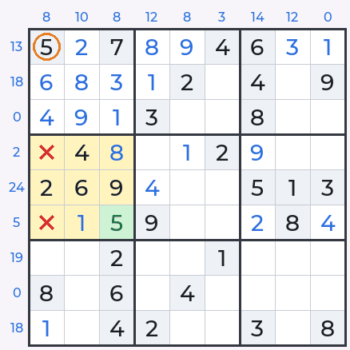

<!-- Written by tools/walkthrough.py sandwich: edit the script, not this page. -->
# Sandwich, step 21: the 5 in box 4

**Step 21 of 53** · [← Step 20](step-20.md) · [All steps](../sandwich.md#the-whole-puzzle-step-by-step) · [Step 22 →](step-22.md)

Box 4 needs a 5. r4c1 and r6c1: column 1 has one (r1c1). Only **r6c3** is left: **r6c3 = 5**.

**Step 21 of 53** · [← Step 20](step-20.md) · [All steps](../sandwich.md#the-whole-puzzle-step-by-step) · [Step 22 →](step-22.md)
