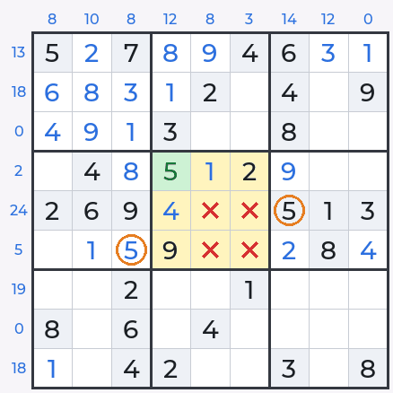

<!-- Written by tools/walkthrough.py sandwich: edit the script, not this page. -->
# Sandwich, step 22: the 5 in box 5

**Step 22 of 53** · [← Step 21](step-21.md) · [All steps](../sandwich.md#the-whole-puzzle-step-by-step) · [Step 23 →](step-23.md)

Box 5 needs a 5. r5c5 and r5c6: row 5 has one (r5c7). r6c5 and r6c6: row 6 has one (r6c3). Only **r4c4** is left: **r4c4 = 5**.

**Step 22 of 53** · [← Step 21](step-21.md) · [All steps](../sandwich.md#the-whole-puzzle-step-by-step) · [Step 23 →](step-23.md)
