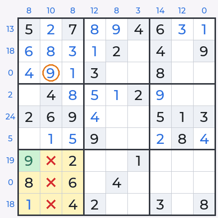

<!-- Written by tools/walkthrough.py sandwich: edit the script, not this page. -->
# Sandwich, step 23: the 9 in box 7

**Step 23 of 53** · [← Step 22](step-22.md) · [All steps](../sandwich.md#the-whole-puzzle-step-by-step) · [Step 24 →](step-24.md)

Box 7 needs a 9. r7c2, r8c2 and r9c2: column 2 has one (r3c2). Only **r7c1** is left: **r7c1 = 9**.

**Step 23 of 53** · [← Step 22](step-22.md) · [All steps](../sandwich.md#the-whole-puzzle-step-by-step) · [Step 24 →](step-24.md)
