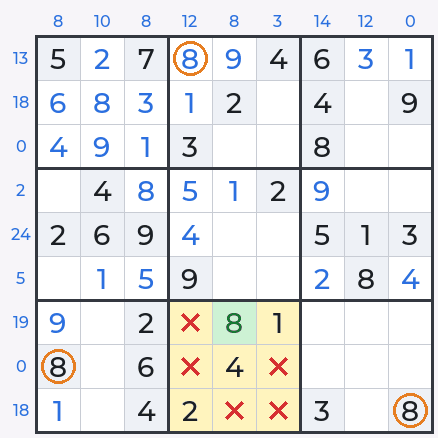

<!-- Written by tools/walkthrough.py sandwich: edit the script, not this page. -->
# Sandwich, step 24: the 8 in box 8

**Step 24 of 53** · [← Step 23](step-23.md) · [All steps](../sandwich.md#the-whole-puzzle-step-by-step) · [Step 25 →](step-25.md)

Box 8 needs an 8. r7c4: column 4 has one (r1c4). r8c4 and r8c6: row 8 has one (r8c1). r9c5 and r9c6: row 9 has one (r9c9). Only **r7c5** is left: **r7c5 = 8**.

**Step 24 of 53** · [← Step 23](step-23.md) · [All steps](../sandwich.md#the-whole-puzzle-step-by-step) · [Step 25 →](step-25.md)
