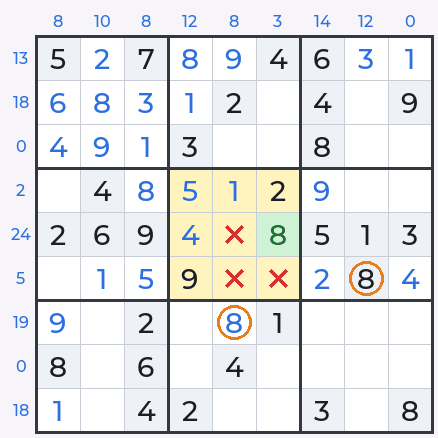

<!-- Written by tools/walkthrough.py sandwich: edit the script, not this page. -->
# Sandwich, step 25: the 8 in box 5

**Step 25 of 53** · [← Step 24](step-24.md) · [All steps](../sandwich.md#the-whole-puzzle-step-by-step) · [Step 26 →](step-26.md)

Box 5 needs an 8. r5c5: column 5 has one (r7c5). r6c5 and r6c6: row 6 has one (r6c8). Only **r5c6** is left: **r5c6 = 8**.

**Step 25 of 53** · [← Step 24](step-24.md) · [All steps](../sandwich.md#the-whole-puzzle-step-by-step) · [Step 26 →](step-26.md)
