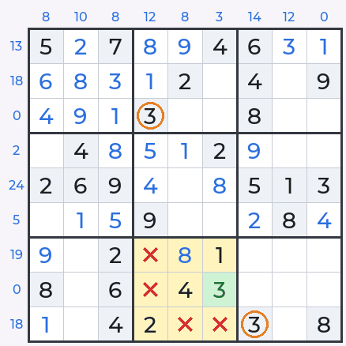

<!-- Written by tools/walkthrough.py sandwich: edit the script, not this page. -->
# Sandwich, step 26: the 3 in box 8

**Step 26 of 53** · [← Step 25](step-25.md) · [All steps](../sandwich.md#the-whole-puzzle-step-by-step) · [Step 27 →](step-27.md)

Box 8 needs a 3. r7c4 and r8c4: column 4 has one (r3c4). r9c5 and r9c6: row 9 has one (r9c7). Only **r8c6** is left: **r8c6 = 3**.

**Step 26 of 53** · [← Step 25](step-25.md) · [All steps](../sandwich.md#the-whole-puzzle-step-by-step) · [Step 27 →](step-27.md)
