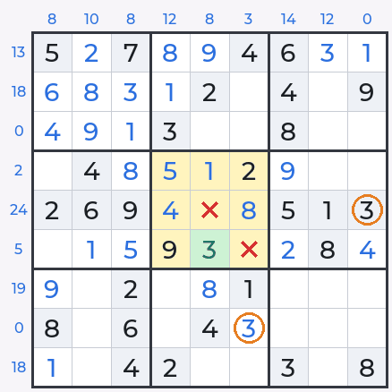

<!-- Written by tools/walkthrough.py sandwich: edit the script, not this page. -->
# Sandwich, step 27: the 3 in box 5

**Step 27 of 53** · [← Step 26](step-26.md) · [All steps](../sandwich.md#the-whole-puzzle-step-by-step) · [Step 28 →](step-28.md)

Box 5 needs a 3. r5c5: row 5 has one (r5c9). r6c6: column 6 has one (r8c6). Only **r6c5** is left: **r6c5 = 3**.

**Step 27 of 53** · [← Step 26](step-26.md) · [All steps](../sandwich.md#the-whole-puzzle-step-by-step) · [Step 28 →](step-28.md)
