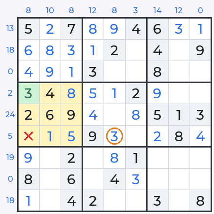

<!-- Written by tools/walkthrough.py sandwich: edit the script, not this page. -->
# Sandwich, step 28: the 3 in box 4

**Step 28 of 53** · [← Step 27](step-27.md) · [All steps](../sandwich.md#the-whole-puzzle-step-by-step) · [Step 29 →](step-29.md)

Box 4 needs a 3. r6c1: row 6 has one (r6c5). Only **r4c1** is left: **r4c1 = 3**.

**Step 28 of 53** · [← Step 27](step-27.md) · [All steps](../sandwich.md#the-whole-puzzle-step-by-step) · [Step 29 →](step-29.md)
