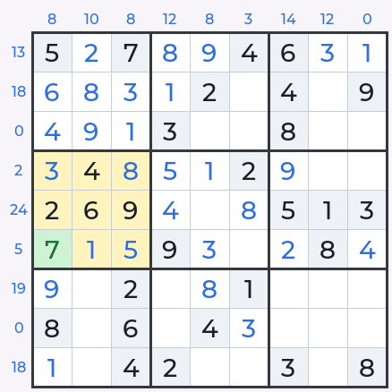

<!-- Written by tools/walkthrough.py sandwich: edit the script, not this page. -->
# Sandwich, step 29: the 7 in box 4

**Step 29 of 53** · [← Step 28](step-28.md) · [All steps](../sandwich.md#the-whole-puzzle-step-by-step) · [Step 30 →](step-30.md)

Box 4 needs a 7, and r6c1 is its last empty cell: **r6c1 = 7**.

**Step 29 of 53** · [← Step 28](step-28.md) · [All steps](../sandwich.md#the-whole-puzzle-step-by-step) · [Step 30 →](step-30.md)
