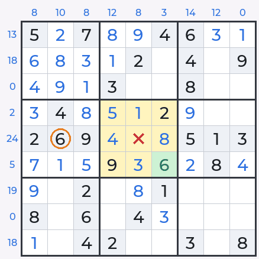

<!-- Written by tools/walkthrough.py sandwich: edit the script, not this page. -->
# Sandwich, step 30: the 6 in box 5

**Step 30 of 53** · [← Step 29](step-29.md) · [All steps](../sandwich.md#the-whole-puzzle-step-by-step) · [Step 31 →](step-31.md)

Box 5 needs a 6. r5c5: row 5 has one (r5c2). Only **r6c6** is left: **r6c6 = 6**.

**Step 30 of 53** · [← Step 29](step-29.md) · [All steps](../sandwich.md#the-whole-puzzle-step-by-step) · [Step 31 →](step-31.md)
