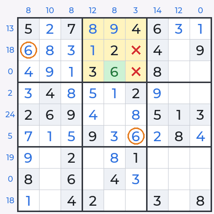

<!-- Written by tools/walkthrough.py sandwich: edit the script, not this page. -->
# Sandwich, step 31: the 6 in box 2

**Step 31 of 53** · [← Step 30](step-30.md) · [All steps](../sandwich.md#the-whole-puzzle-step-by-step) · [Step 32 →](step-32.md)

Box 2 needs a 6. r2c6: row 2 has one (r2c1). r3c6: column 6 has one (r6c6). Only **r3c5** is left: **r3c5 = 6**.

**Step 31 of 53** · [← Step 30](step-30.md) · [All steps](../sandwich.md#the-whole-puzzle-step-by-step) · [Step 32 →](step-32.md)
