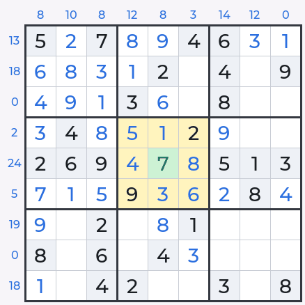

<!-- Written by tools/walkthrough.py sandwich: edit the script, not this page. -->
# Sandwich, step 32: the 7 in box 5

**Step 32 of 53** · [← Step 31](step-31.md) · [All steps](../sandwich.md#the-whole-puzzle-step-by-step) · [Step 33 →](step-33.md)

Box 5 needs a 7, and r5c5 is its last empty cell: **r5c5 = 7**.

**Step 32 of 53** · [← Step 31](step-31.md) · [All steps](../sandwich.md#the-whole-puzzle-step-by-step) · [Step 33 →](step-33.md)
