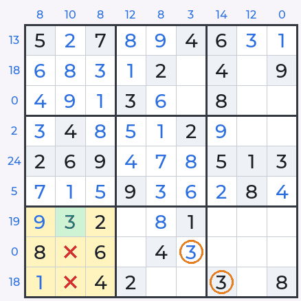

<!-- Written by tools/walkthrough.py sandwich: edit the script, not this page. -->
# Sandwich, step 33: the 3 in box 7

**Step 33 of 53** · [← Step 32](step-32.md) · [All steps](../sandwich.md#the-whole-puzzle-step-by-step) · [Step 34 →](step-34.md)

Box 7 needs a 3. r8c2: row 8 has one (r8c6). r9c2: row 9 has one (r9c7). Only **r7c2** is left: **r7c2 = 3**.

**Step 33 of 53** · [← Step 32](step-32.md) · [All steps](../sandwich.md#the-whole-puzzle-step-by-step) · [Step 34 →](step-34.md)
