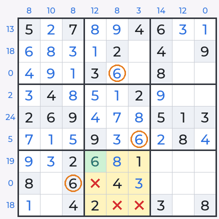

<!-- Written by tools/walkthrough.py sandwich: edit the script, not this page. -->
# Sandwich, step 34: the 6 in box 8

**Step 34 of 53** · [← Step 33](step-33.md) · [All steps](../sandwich.md#the-whole-puzzle-step-by-step) · [Step 35 →](step-35.md)

Box 8 needs a 6. r8c4: row 8 has one (r8c3). r9c5: column 5 has one (r3c5). r9c6: column 6 has one (r6c6). Only **r7c4** is left: **r7c4 = 6**.

**Step 34 of 53** · [← Step 33](step-33.md) · [All steps](../sandwich.md#the-whole-puzzle-step-by-step) · [Step 35 →](step-35.md)
