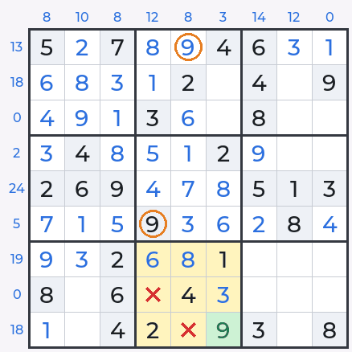

<!-- Written by tools/walkthrough.py sandwich: edit the script, not this page. -->
# Sandwich, step 35: the 9 in box 8

**Step 35 of 53** · [← Step 34](step-34.md) · [All steps](../sandwich.md#the-whole-puzzle-step-by-step) · [Step 36 →](step-36.md)

Box 8 needs a 9. r8c4: column 4 has one (r6c4). r9c5: column 5 has one (r1c5). Only **r9c6** is left: **r9c6 = 9**.

**Step 35 of 53** · [← Step 34](step-34.md) · [All steps](../sandwich.md#the-whole-puzzle-step-by-step) · [Step 36 →](step-36.md)
