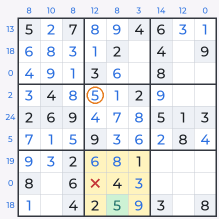

<!-- Written by tools/walkthrough.py sandwich: edit the script, not this page. -->
# Sandwich, step 36: the 5 in box 8

**Step 36 of 53** · [← Step 35](step-35.md) · [All steps](../sandwich.md#the-whole-puzzle-step-by-step) · [Step 37 →](step-37.md)

Box 8 needs a 5. r8c4: column 4 has one (r4c4). Only **r9c5** is left: **r9c5 = 5**.

**Step 36 of 53** · [← Step 35](step-35.md) · [All steps](../sandwich.md#the-whole-puzzle-step-by-step) · [Step 37 →](step-37.md)
