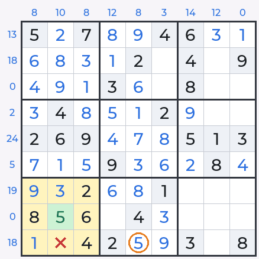

<!-- Written by tools/walkthrough.py sandwich: edit the script, not this page. -->
# Sandwich, step 37: the 5 in box 7

**Step 37 of 53** · [← Step 36](step-36.md) · [All steps](../sandwich.md#the-whole-puzzle-step-by-step) · [Step 38 →](step-38.md)

Box 7 needs a 5. r9c2: row 9 has one (r9c5). Only **r8c2** is left: **r8c2 = 5**.

**Step 37 of 53** · [← Step 36](step-36.md) · [All steps](../sandwich.md#the-whole-puzzle-step-by-step) · [Step 38 →](step-38.md)
