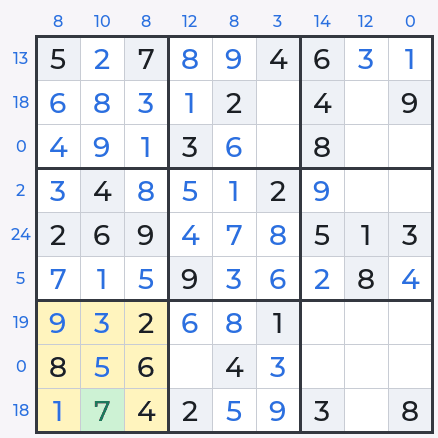

<!-- Written by tools/walkthrough.py sandwich: edit the script, not this page. -->
# Sandwich, step 38: the 7 in box 7

**Step 38 of 53** · [← Step 37](step-37.md) · [All steps](../sandwich.md#the-whole-puzzle-step-by-step) · [Step 39 →](step-39.md)

Box 7 needs a 7, and r9c2 is its last empty cell: **r9c2 = 7**.

**Step 38 of 53** · [← Step 37](step-37.md) · [All steps](../sandwich.md#the-whole-puzzle-step-by-step) · [Step 39 →](step-39.md)
