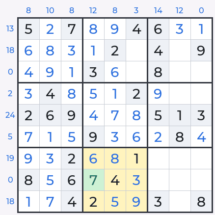

<!-- Written by tools/walkthrough.py sandwich: edit the script, not this page. -->
# Sandwich, step 39: the 7 in box 8

**Step 39 of 53** · [← Step 38](step-38.md) · [All steps](../sandwich.md#the-whole-puzzle-step-by-step) · [Step 40 →](step-40.md)

Box 8 needs a 7, and r8c4 is its last empty cell: **r8c4 = 7**.

**Step 39 of 53** · [← Step 38](step-38.md) · [All steps](../sandwich.md#the-whole-puzzle-step-by-step) · [Step 40 →](step-40.md)
