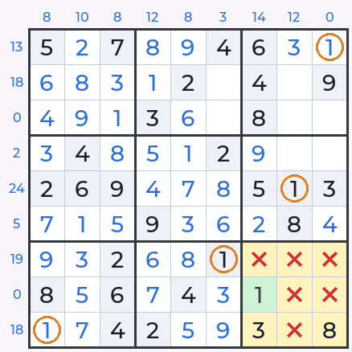

<!-- Written by tools/walkthrough.py sandwich: edit the script, not this page. -->
# Sandwich, step 40: the 1 in box 9

**Step 40 of 53** · [← Step 39](step-39.md) · [All steps](../sandwich.md#the-whole-puzzle-step-by-step) · [Step 41 →](step-41.md)

Box 9 needs a 1. r7c7, r7c8 and r7c9: row 7 has one (r7c6). r8c8: column 8 has one (r5c8). r8c9: column 9 has one (r1c9). r9c8: row 9 has one (r9c1). Only **r8c7** is left: **r8c7 = 1**.

**Step 40 of 53** · [← Step 39](step-39.md) · [All steps](../sandwich.md#the-whole-puzzle-step-by-step) · [Step 41 →](step-41.md)
