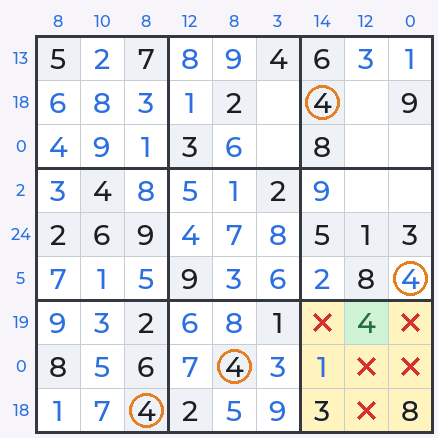

<!-- Written by tools/walkthrough.py sandwich: edit the script, not this page. -->
# Sandwich, step 41: the 4 in box 9

**Step 41 of 53** · [← Step 40](step-40.md) · [All steps](../sandwich.md#the-whole-puzzle-step-by-step) · [Step 42 →](step-42.md)

Box 9 needs a 4. r7c7: column 7 has one (r2c7). r7c9: column 9 has one (r6c9). r8c8 and r8c9: row 8 has one (r8c5). r9c8: row 9 has one (r9c3). Only **r7c8** is left: **r7c8 = 4**.

**Step 41 of 53** · [← Step 40](step-40.md) · [All steps](../sandwich.md#the-whole-puzzle-step-by-step) · [Step 42 →](step-42.md)
