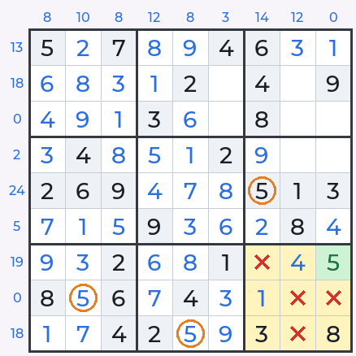

<!-- Written by tools/walkthrough.py sandwich: edit the script, not this page. -->
# Sandwich, step 42: the 5 in box 9

**Step 42 of 53** · [← Step 41](step-41.md) · [All steps](../sandwich.md#the-whole-puzzle-step-by-step) · [Step 43 →](step-43.md)

Box 9 needs a 5. r7c7: column 7 has one (r5c7). r8c8 and r8c9: row 8 has one (r8c2). r9c8: row 9 has one (r9c5). Only **r7c9** is left: **r7c9 = 5**.

**Step 42 of 53** · [← Step 41](step-41.md) · [All steps](../sandwich.md#the-whole-puzzle-step-by-step) · [Step 43 →](step-43.md)
