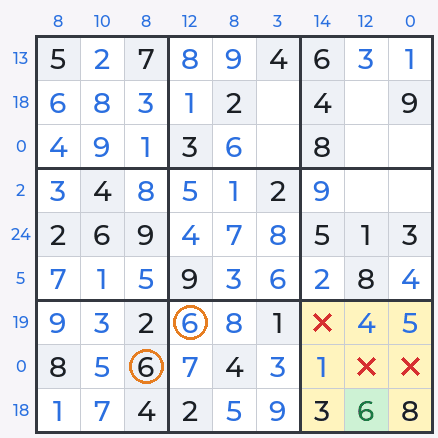

<!-- Written by tools/walkthrough.py sandwich: edit the script, not this page. -->
# Sandwich, step 43: the 6 in box 9

**Step 43 of 53** · [← Step 42](step-42.md) · [All steps](../sandwich.md#the-whole-puzzle-step-by-step) · [Step 44 →](step-44.md)

Box 9 needs a 6. r7c7: row 7 has one (r7c4). r8c8 and r8c9: row 8 has one (r8c3). Only **r9c8** is left: **r9c8 = 6**.

**Step 43 of 53** · [← Step 42](step-42.md) · [All steps](../sandwich.md#the-whole-puzzle-step-by-step) · [Step 44 →](step-44.md)
