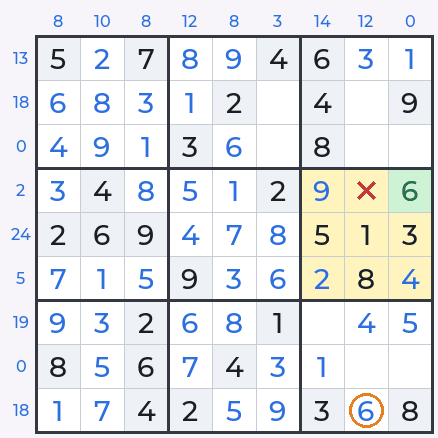

<!-- Written by tools/walkthrough.py sandwich: edit the script, not this page. -->
# Sandwich, step 44: the 6 in box 6

**Step 44 of 53** · [← Step 43](step-43.md) · [All steps](../sandwich.md#the-whole-puzzle-step-by-step) · [Step 45 →](step-45.md)

Box 6 needs a 6. r4c8: column 8 has one (r9c8). Only **r4c9** is left: **r4c9 = 6**.

**Step 44 of 53** · [← Step 43](step-43.md) · [All steps](../sandwich.md#the-whole-puzzle-step-by-step) · [Step 45 →](step-45.md)
