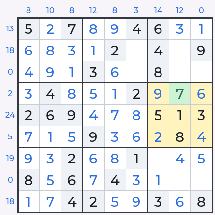

<!-- Written by tools/walkthrough.py sandwich: edit the script, not this page. -->
# Sandwich, step 45: the 7 in box 6

**Step 45 of 53** · [← Step 44](step-44.md) · [All steps](../sandwich.md#the-whole-puzzle-step-by-step) · [Step 46 →](step-46.md)

Box 6 needs a 7, and r4c8 is its last empty cell: **r4c8 = 7**.

**Step 45 of 53** · [← Step 44](step-44.md) · [All steps](../sandwich.md#the-whole-puzzle-step-by-step) · [Step 46 →](step-46.md)
