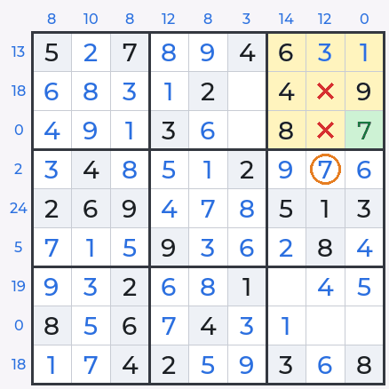

<!-- Written by tools/walkthrough.py sandwich: edit the script, not this page. -->
# Sandwich, step 46: the 7 in box 3

**Step 46 of 53** · [← Step 45](step-45.md) · [All steps](../sandwich.md#the-whole-puzzle-step-by-step) · [Step 47 →](step-47.md)

Box 3 needs a 7. r2c8 and r3c8: column 8 has one (r4c8). Only **r3c9** is left: **r3c9 = 7**.

**Step 46 of 53** · [← Step 45](step-45.md) · [All steps](../sandwich.md#the-whole-puzzle-step-by-step) · [Step 47 →](step-47.md)
