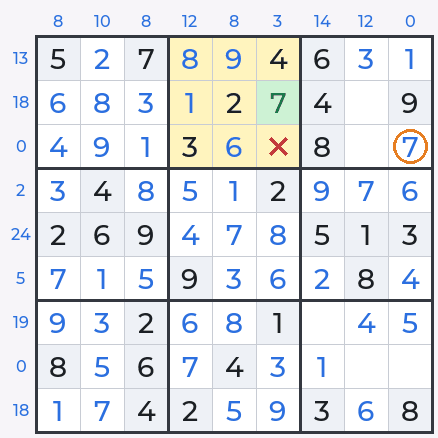

<!-- Written by tools/walkthrough.py sandwich: edit the script, not this page. -->
# Sandwich, step 47: the 7 in box 2

**Step 47 of 53** · [← Step 46](step-46.md) · [All steps](../sandwich.md#the-whole-puzzle-step-by-step) · [Step 48 →](step-48.md)

Box 2 needs a 7. r3c6: row 3 has one (r3c9). Only **r2c6** is left: **r2c6 = 7**.

**Step 47 of 53** · [← Step 46](step-46.md) · [All steps](../sandwich.md#the-whole-puzzle-step-by-step) · [Step 48 →](step-48.md)
