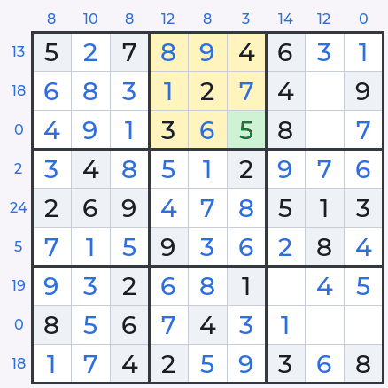

<!-- Written by tools/walkthrough.py sandwich: edit the script, not this page. -->
# Sandwich, step 48: the 5 in box 2

**Step 48 of 53** · [← Step 47](step-47.md) · [All steps](../sandwich.md#the-whole-puzzle-step-by-step) · [Step 49 →](step-49.md)

Box 2 needs a 5, and r3c6 is its last empty cell: **r3c6 = 5**.

**Step 48 of 53** · [← Step 47](step-47.md) · [All steps](../sandwich.md#the-whole-puzzle-step-by-step) · [Step 49 →](step-49.md)
