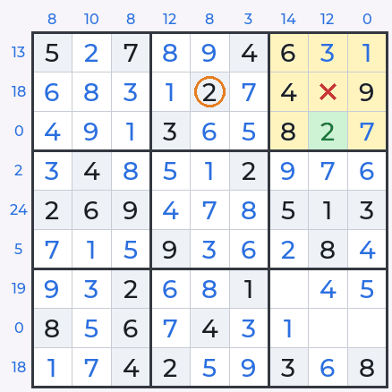

<!-- Written by tools/walkthrough.py sandwich: edit the script, not this page. -->
# Sandwich, step 49: the 2 in box 3

**Step 49 of 53** · [← Step 48](step-48.md) · [All steps](../sandwich.md#the-whole-puzzle-step-by-step) · [Step 50 →](step-50.md)

Box 3 needs a 2. r2c8: row 2 has one (r2c5). Only **r3c8** is left: **r3c8 = 2**.

**Step 49 of 53** · [← Step 48](step-48.md) · [All steps](../sandwich.md#the-whole-puzzle-step-by-step) · [Step 50 →](step-50.md)
