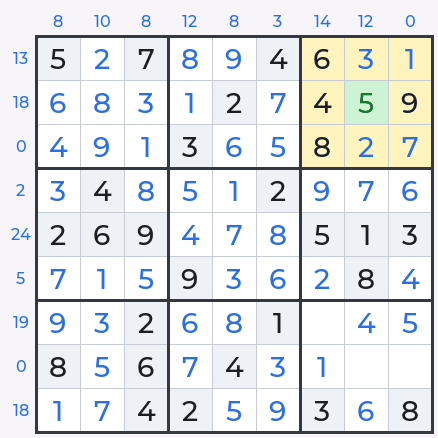

<!-- Written by tools/walkthrough.py sandwich: edit the script, not this page. -->
# Sandwich, step 50: the 5 in box 3

**Step 50 of 53** · [← Step 49](step-49.md) · [All steps](../sandwich.md#the-whole-puzzle-step-by-step) · [Step 51 →](step-51.md)

Box 3 needs a 5, and r2c8 is its last empty cell: **r2c8 = 5**.

**Step 50 of 53** · [← Step 49](step-49.md) · [All steps](../sandwich.md#the-whole-puzzle-step-by-step) · [Step 51 →](step-51.md)
