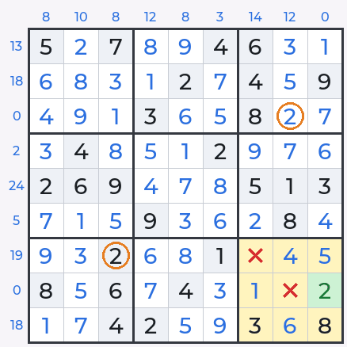

<!-- Written by tools/walkthrough.py sandwich: edit the script, not this page. -->
# Sandwich, step 51: the 2 in box 9

**Step 51 of 53** · [← Step 50](step-50.md) · [All steps](../sandwich.md#the-whole-puzzle-step-by-step) · [Step 52 →](step-52.md)

Box 9 needs a 2. r7c7: row 7 has one (r7c3). r8c8: column 8 has one (r3c8). Only **r8c9** is left: **r8c9 = 2**.

**Step 51 of 53** · [← Step 50](step-50.md) · [All steps](../sandwich.md#the-whole-puzzle-step-by-step) · [Step 52 →](step-52.md)
