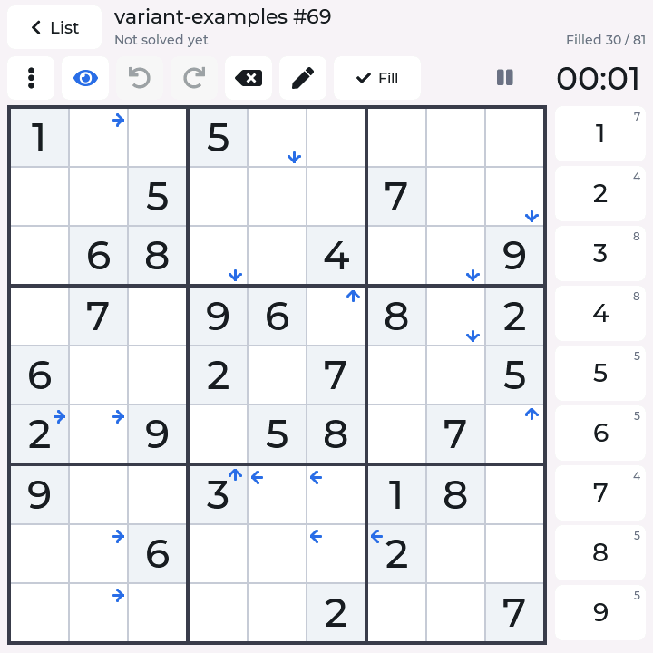
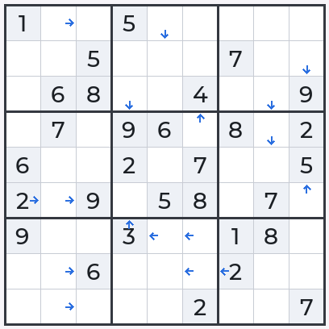

# Search Nine

[← All variants](README.md) · [Puzzles](../features-puzzles.md) · [How to play](../how-to-play.md)

## The rules

[Classic](classic.md) rules, and **arrows in cells**: an arrow points along its row or column, and the cell's digit is **how many cells away the 9 is** that way. A 3 with an arrow pointing right has the row's 9 three cells to its right. An arrow's cell is never 9, and a cell without an arrow says nothing.

## On the board

- The arrows sit by the side of their cell they point to, small, so the digit stays readable.
- When an arrow's digit reaches a cell that holds another digit, or the line's 9 is somewhere else, the arrow's cell turns red (with that cell or that 9); so does a distance that runs off the board.
- The grader and hints know one step, in three forms: an arrow's cell keeps only the distances that reach a cell that can still be 9 ("Of the cells down from the arrow in row 3, column 4, only those that can be 9 leave it only 1"); a cell behind an arrow, or one its digit can't reach, isn't 9; and once an arrow has its digit, the cell that far is the 9.
- **Puzzles → ⋮ → New puzzle → Marks → Search Nine**: most cells whose digit is the distance to their row's or column's 9 get an arrow (four fifths of them; Hard and Expert: three fifths), usually 10 to 14 arrows.

## How to solve it

- **The 9 is never behind an arrow.** An arrow says where its line's 9 is: every cell the other way, and the arrow's own cell, is no 9.
- **Count to the edge.** An arrow two cells from the edge it points to holds 1 or 2; one by the edge always holds 1.
- **A digit is a 9 placed.** Once an arrow's cell is filled, count that many cells: that's the 9.
- **A 9 fixes its arrows.** Once a line's 9 is in, every arrow in that line pointing at it holds its distance.

## Worked example

**variant-examples #69**, Search Nine Easy (see [Classic](classic.md#worked-example-the-whole-puzzle) for how to import the examples; cells are written r*row*c*column*).

**Step 1: r3c4.** Row 3 has 6, 8, 4 and 9; column 4 has 5, 9, 2 and 3. By the Classic rules r3c4 could be 1 or 7. Its arrow points down, and 7 cells down from row 3 is off the board. **r3c4 = 1**.

**Step 2: r4c6.** Row 4 has 7, 9, 6, 8 and 2; column 6 has 4; box 5 has 5. By the Classic rules r4c6 could be 1 or 3. Its arrow points up: a 1 would put the column's 9 in r3c6, which holds 4. **r4c6 = 3**.

**Step 3: r1c6.** The 3 in r4c6 points up three cells, to r1c6: that's column 6's 9. (By the Classic rules it could be 6 or 9.) **r1c6 = 9**.

## The whole puzzle, step by step

<!-- walkthrough -->
<!-- Written by tools/walkthrough.py search-nine: edit the script, not this part. -->

The whole puzzle, from the start to the last cell: 51 steps, each one a single (one place left for a digit, or one digit left for a cell), taken in the order a box's single comes first, so not quite the order of the worked example above. Each step has a page of its own, with **Previous** and **Next**: pick its number below. In each picture, the unit the step looks at is tinted yellow (for a cell with one digit left: its row, column and box), the new digit is on green, the digits that rule cells out have an **orange ring**, and the empty cells they rule out a **red cross**. Givens are on grey, digits from earlier steps in blue.

| [1](search-nine/step-01.md) | [2](search-nine/step-02.md) | [3](search-nine/step-03.md) | [4](search-nine/step-04.md) | [5](search-nine/step-05.md) | [6](search-nine/step-06.md) | [7](search-nine/step-07.md) | [8](search-nine/step-08.md) | [9](search-nine/step-09.md) | [10](search-nine/step-10.md) |
|:-:|:-:|:-:|:-:|:-:|:-:|:-:|:-:|:-:|:-:|
| [11](search-nine/step-11.md) | [12](search-nine/step-12.md) | [13](search-nine/step-13.md) | [14](search-nine/step-14.md) | [15](search-nine/step-15.md) | [16](search-nine/step-16.md) | [17](search-nine/step-17.md) | [18](search-nine/step-18.md) | [19](search-nine/step-19.md) | [20](search-nine/step-20.md) |
| [21](search-nine/step-21.md) | [22](search-nine/step-22.md) | [23](search-nine/step-23.md) | [24](search-nine/step-24.md) | [25](search-nine/step-25.md) | [26](search-nine/step-26.md) | [27](search-nine/step-27.md) | [28](search-nine/step-28.md) | [29](search-nine/step-29.md) | [30](search-nine/step-30.md) |
| [31](search-nine/step-31.md) | [32](search-nine/step-32.md) | [33](search-nine/step-33.md) | [34](search-nine/step-34.md) | [35](search-nine/step-35.md) | [36](search-nine/step-36.md) | [37](search-nine/step-37.md) | [38](search-nine/step-38.md) | [39](search-nine/step-39.md) | [40](search-nine/step-40.md) |
| [41](search-nine/step-41.md) | [42](search-nine/step-42.md) | [43](search-nine/step-43.md) | [44](search-nine/step-44.md) | [45](search-nine/step-45.md) | [46](search-nine/step-46.md) | [47](search-nine/step-47.md) | [48](search-nine/step-48.md) | [49](search-nine/step-49.md) | [50](search-nine/step-50.md) |
| [51](search-nine/step-51.md) |  |  |  |  |  |  |  |  |  |

Solved.

<!-- /walkthrough -->
