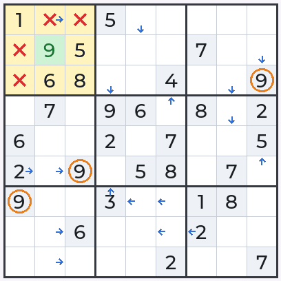

<!-- Written by tools/walkthrough.py search-nine: edit the script, not this page. -->
# Search Nine, step 1: the 9 in box 1

**Step 1 of 51** · [← The start](../search-nine.md#the-whole-puzzle-step-by-step) · [All steps](../search-nine.md#the-whole-puzzle-step-by-step) · [Step 2 →](step-02.md)

Box 1 needs a 9. r1c3: column 3 has one (r6c3). r2c1: column 1 has one (r7c1). r3c1: row 3 has one (r3c9). r1c2: it has an arrow, pointing right to its 9, so it isn't the 9 itself. Only **r2c2** is left: **r2c2 = 9**.

**Step 1 of 51** · [← The start](../search-nine.md#the-whole-puzzle-step-by-step) · [All steps](../search-nine.md#the-whole-puzzle-step-by-step) · [Step 2 →](step-02.md)
