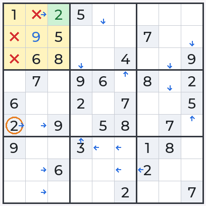

<!-- Written by tools/walkthrough.py search-nine: edit the script, not this page. -->
# Search Nine, step 2: the 2 in box 1

**Step 2 of 51** · [← Step 1](step-01.md) · [All steps](../search-nine.md#the-whole-puzzle-step-by-step) · [Step 3 →](step-03.md)

Box 1 needs a 2. r2c1 and r3c1: column 1 has one (r6c1). r1c2: its arrow points right, and 2 cells that way, r1c4 is 5, not the 9. Only **r1c3** is left: **r1c3 = 2**.

**Step 2 of 51** · [← Step 1](step-01.md) · [All steps](../search-nine.md#the-whole-puzzle-step-by-step) · [Step 3 →](step-03.md)
