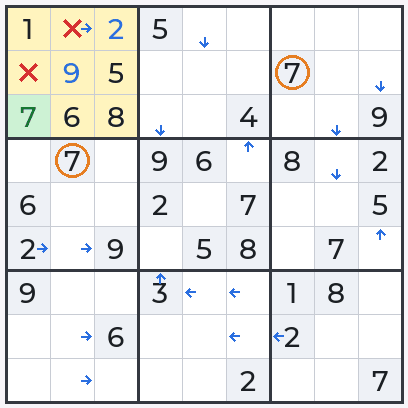

<!-- Written by tools/walkthrough.py search-nine: edit the script, not this page. -->
# Search Nine, step 3: the 7 in box 1

**Step 3 of 51** · [← Step 2](step-02.md) · [All steps](../search-nine.md#the-whole-puzzle-step-by-step) · [Step 4 →](step-04.md)

Box 1 needs a 7. r1c2: column 2 has one (r4c2). r2c1: row 2 has one (r2c7). Only **r3c1** is left: **r3c1 = 7**.

**Step 3 of 51** · [← Step 2](step-02.md) · [All steps](../search-nine.md#the-whole-puzzle-step-by-step) · [Step 4 →](step-04.md)
