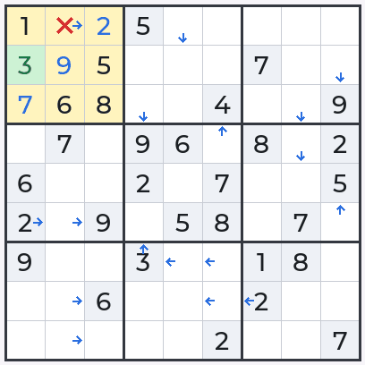

<!-- Written by tools/walkthrough.py search-nine: edit the script, not this page. -->
# Search Nine, step 4: the 3 in box 1

**Step 4 of 51** · [← Step 3](step-03.md) · [All steps](../search-nine.md#the-whole-puzzle-step-by-step) · [Step 5 →](step-05.md)

Box 1 needs a 3. r1c2: its arrow points right, and 3 cells that way, r1c5 can't be the 9. Only **r2c1** is left: **r2c1 = 3**.

**Step 4 of 51** · [← Step 3](step-03.md) · [All steps](../search-nine.md#the-whole-puzzle-step-by-step) · [Step 5 →](step-05.md)
