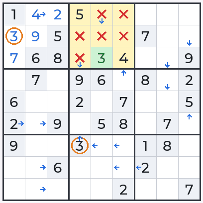

<!-- Written by tools/walkthrough.py search-nine: edit the script, not this page. -->
# Search Nine, step 6: the 3 in box 2

**Step 6 of 51** · [← Step 5](step-05.md) · [All steps](../search-nine.md#the-whole-puzzle-step-by-step) · [Step 7 →](step-07.md)

Box 2 needs a 3. r2c4, r2c5 and r2c6: row 2 has one (r2c1). r3c4: column 4 has one (r7c4). r1c5: its arrow points down, and 3 cells that way, r4c5 is 6, not the 9. r1c6: the 4 in r1c2 points right at it, 4 cells away: it's the 9. Only **r3c5** is left: **r3c5 = 3**.

**Step 6 of 51** · [← Step 5](step-05.md) · [All steps](../search-nine.md#the-whole-puzzle-step-by-step) · [Step 7 →](step-07.md)
