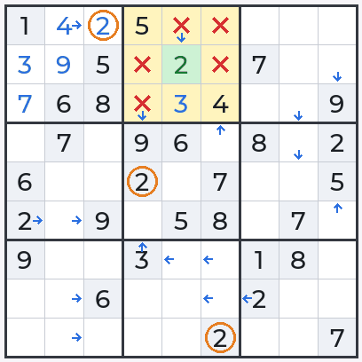

<!-- Written by tools/walkthrough.py search-nine: edit the script, not this page. -->
# Search Nine, step 7: the 2 in box 2

**Step 7 of 51** · [← Step 6](step-06.md) · [All steps](../search-nine.md#the-whole-puzzle-step-by-step) · [Step 8 →](step-08.md)

Box 2 needs a 2. r1c5 and r1c6: row 1 has one (r1c3). r2c4 and r3c4: column 4 has one (r5c4). r2c6: column 6 has one (r9c6). Only **r2c5** is left: **r2c5 = 2**.

**Step 7 of 51** · [← Step 6](step-06.md) · [All steps](../search-nine.md#the-whole-puzzle-step-by-step) · [Step 8 →](step-08.md)
