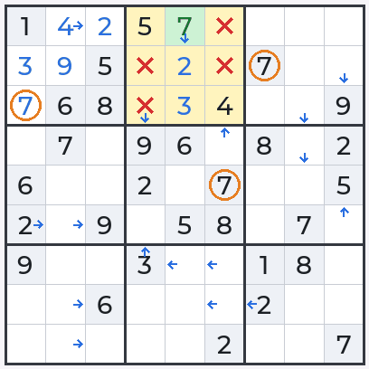

<!-- Written by tools/walkthrough.py search-nine: edit the script, not this page. -->
# Search Nine, step 8: the 7 in box 2

**Step 8 of 51** · [← Step 7](step-07.md) · [All steps](../search-nine.md#the-whole-puzzle-step-by-step) · [Step 9 →](step-09.md)

Box 2 needs a 7. r1c6: column 6 has one (r5c6). r2c4 and r2c6: row 2 has one (r2c7). r3c4: row 3 has one (r3c1). Only **r1c5** is left: **r1c5 = 7**.

**Step 8 of 51** · [← Step 7](step-07.md) · [All steps](../search-nine.md#the-whole-puzzle-step-by-step) · [Step 9 →](step-09.md)
