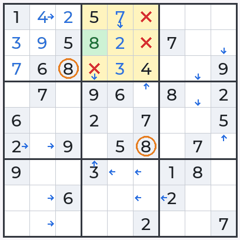

<!-- Written by tools/walkthrough.py search-nine: edit the script, not this page. -->
# Search Nine, step 9: the 8 in box 2

**Step 9 of 51** · [← Step 8](step-08.md) · [All steps](../search-nine.md#the-whole-puzzle-step-by-step) · [Step 10 →](step-10.md)

Box 2 needs an 8. r1c6 and r2c6: column 6 has one (r6c6). r3c4: row 3 has one (r3c3). Only **r2c4** is left: **r2c4 = 8**.

**Step 9 of 51** · [← Step 8](step-08.md) · [All steps](../search-nine.md#the-whole-puzzle-step-by-step) · [Step 10 →](step-10.md)
