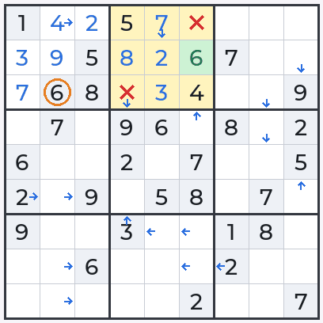

<!-- Written by tools/walkthrough.py search-nine: edit the script, not this page. -->
# Search Nine, step 10: the 6 in box 2

**Step 10 of 51** · [← Step 9](step-09.md) · [All steps](../search-nine.md#the-whole-puzzle-step-by-step) · [Step 11 →](step-11.md)

Box 2 needs a 6. r3c4: row 3 has one (r3c2). r1c6: the 4 in r1c2 points right at it, 4 cells away: it's the 9. Only **r2c6** is left: **r2c6 = 6**.

**Step 10 of 51** · [← Step 9](step-09.md) · [All steps](../search-nine.md#the-whole-puzzle-step-by-step) · [Step 11 →](step-11.md)
