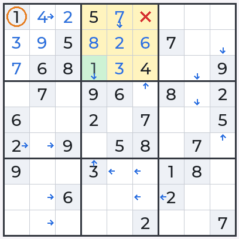

<!-- Written by tools/walkthrough.py search-nine: edit the script, not this page. -->
# Search Nine, step 11: the 1 in box 2

**Step 11 of 51** · [← Step 10](step-10.md) · [All steps](../search-nine.md#the-whole-puzzle-step-by-step) · [Step 12 →](step-12.md)

Box 2 needs a 1. r1c6: row 1 has one (r1c1). Only **r3c4** is left: **r3c4 = 1**.

**Step 11 of 51** · [← Step 10](step-10.md) · [All steps](../search-nine.md#the-whole-puzzle-step-by-step) · [Step 12 →](step-12.md)
