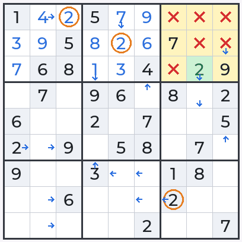

<!-- Written by tools/walkthrough.py search-nine: edit the script, not this page. -->
# Search Nine, step 13: the 2 in box 3

**Step 13 of 51** · [← Step 12](step-12.md) · [All steps](../search-nine.md#the-whole-puzzle-step-by-step) · [Step 14 →](step-14.md)

Box 3 needs a 2. r1c7, r1c8 and r1c9: row 1 has one (r1c3). r2c8 and r2c9: row 2 has one (r2c5). r3c7: column 7 has one (r8c7). Only **r3c8** is left: **r3c8 = 2**.

**Step 13 of 51** · [← Step 12](step-12.md) · [All steps](../search-nine.md#the-whole-puzzle-step-by-step) · [Step 14 →](step-14.md)
