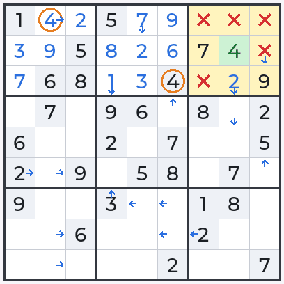

<!-- Written by tools/walkthrough.py search-nine: edit the script, not this page. -->
# Search Nine, step 14: the 4 in box 3

**Step 14 of 51** · [← Step 13](step-13.md) · [All steps](../search-nine.md#the-whole-puzzle-step-by-step) · [Step 15 →](step-15.md)

Box 3 needs a 4. r1c7, r1c8 and r1c9: row 1 has one (r1c2). r3c7: row 3 has one (r3c6). r2c9: its arrow points down, and 4 cells that way, r6c9 can't be the 9. Only **r2c8** is left: **r2c8 = 4**.

**Step 14 of 51** · [← Step 13](step-13.md) · [All steps](../search-nine.md#the-whole-puzzle-step-by-step) · [Step 15 →](step-15.md)
