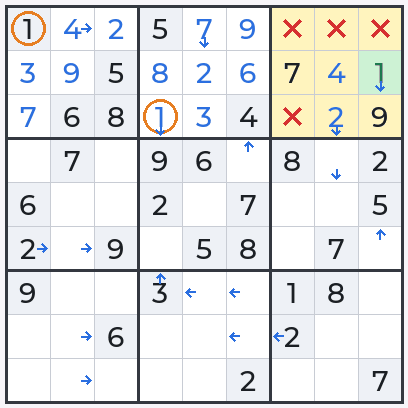

<!-- Written by tools/walkthrough.py search-nine: edit the script, not this page. -->
# Search Nine, step 15: the 1 in box 3

**Step 15 of 51** · [← Step 14](step-14.md) · [All steps](../search-nine.md#the-whole-puzzle-step-by-step) · [Step 16 →](step-16.md)

Box 3 needs a 1. r1c7, r1c8 and r1c9: row 1 has one (r1c1). r3c7: row 3 has one (r3c4). Only **r2c9** is left: **r2c9 = 1**.

**Step 15 of 51** · [← Step 14](step-14.md) · [All steps](../search-nine.md#the-whole-puzzle-step-by-step) · [Step 16 →](step-16.md)
