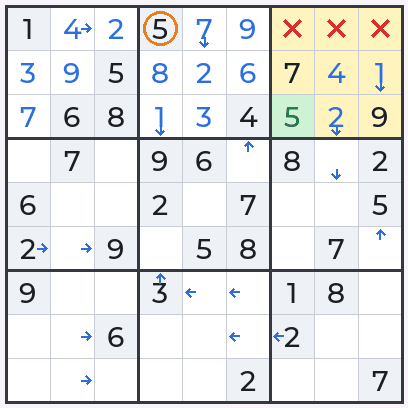

<!-- Written by tools/walkthrough.py search-nine: edit the script, not this page. -->
# Search Nine, step 16: the 5 in box 3

**Step 16 of 51** · [← Step 15](step-15.md) · [All steps](../search-nine.md#the-whole-puzzle-step-by-step) · [Step 17 →](step-17.md)

Box 3 needs a 5. r1c7, r1c8 and r1c9: row 1 has one (r1c4). Only **r3c7** is left: **r3c7 = 5**.

**Step 16 of 51** · [← Step 15](step-15.md) · [All steps](../search-nine.md#the-whole-puzzle-step-by-step) · [Step 17 →](step-17.md)
