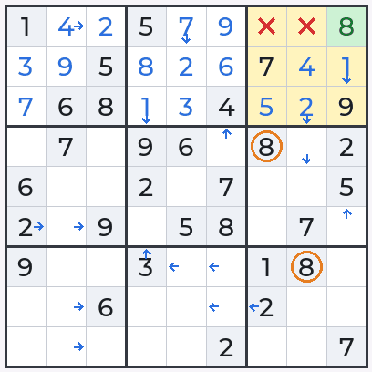

<!-- Written by tools/walkthrough.py search-nine: edit the script, not this page. -->
# Search Nine, step 17: the 8 in box 3

**Step 17 of 51** · [← Step 16](step-16.md) · [All steps](../search-nine.md#the-whole-puzzle-step-by-step) · [Step 18 →](step-18.md)

Box 3 needs an 8. r1c7: column 7 has one (r4c7). r1c8: column 8 has one (r7c8). Only **r1c9** is left: **r1c9 = 8**.

**Step 17 of 51** · [← Step 16](step-16.md) · [All steps](../search-nine.md#the-whole-puzzle-step-by-step) · [Step 18 →](step-18.md)
