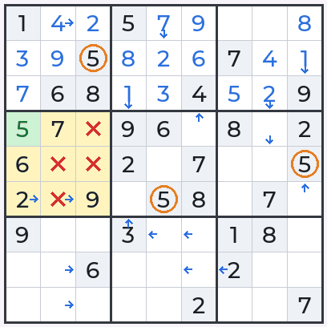

<!-- Written by tools/walkthrough.py search-nine: edit the script, not this page. -->
# Search Nine, step 18: the 5 in box 4

**Step 18 of 51** · [← Step 17](step-17.md) · [All steps](../search-nine.md#the-whole-puzzle-step-by-step) · [Step 19 →](step-19.md)

Box 4 needs a 5. r4c3: column 3 has one (r2c3). r5c2 and r5c3: row 5 has one (r5c9). r6c2: row 6 has one (r6c5). Only **r4c1** is left: **r4c1 = 5**.

**Step 18 of 51** · [← Step 17](step-17.md) · [All steps](../search-nine.md#the-whole-puzzle-step-by-step) · [Step 19 →](step-19.md)
