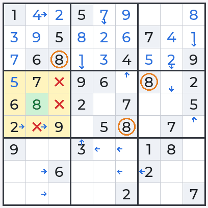

<!-- Written by tools/walkthrough.py search-nine: edit the script, not this page. -->
# Search Nine, step 19: the 8 in box 4

**Step 19 of 51** · [← Step 18](step-18.md) · [All steps](../search-nine.md#the-whole-puzzle-step-by-step) · [Step 20 →](step-20.md)

Box 4 needs an 8. r4c3: row 4 has one (r4c7). r5c3: column 3 has one (r3c3). r6c2: row 6 has one (r6c6). Only **r5c2** is left: **r5c2 = 8**.

**Step 19 of 51** · [← Step 18](step-18.md) · [All steps](../search-nine.md#the-whole-puzzle-step-by-step) · [Step 20 →](step-20.md)
