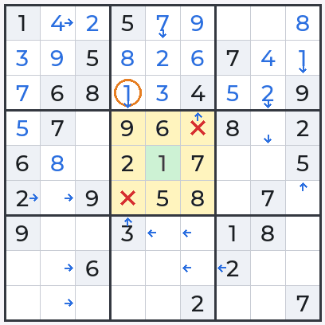

<!-- Written by tools/walkthrough.py search-nine: edit the script, not this page. -->
# Search Nine, step 20: the 1 in box 5

**Step 20 of 51** · [← Step 19](step-19.md) · [All steps](../search-nine.md#the-whole-puzzle-step-by-step) · [Step 21 →](step-21.md)

Box 5 needs a 1. r6c4: column 4 has one (r3c4). r4c6: its arrow points up, and 1 cell that way, r3c6 is 4, not the 9. Only **r5c5** is left: **r5c5 = 1**.

**Step 20 of 51** · [← Step 19](step-19.md) · [All steps](../search-nine.md#the-whole-puzzle-step-by-step) · [Step 21 →](step-21.md)
